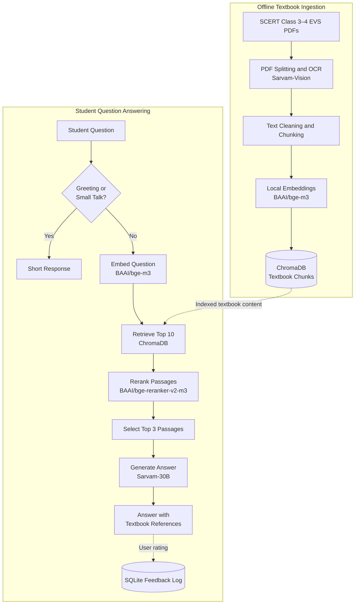

# Jonaki (জোনাকী) — Assamese AI Tutor for Primary Education


[](https://www.python.org/)
[](https://www.gnu.org/licenses/gpl-3.0)
[](https://chainlit.io/)
[](https://github.com/AvinabhDutta-Dev/jonaki)

**Status: Baseline prototype.** This repository contains the initial working prototype of Jonaki, built as a major B.Tech project — scoped to Class 3 & 4 Environmental Science (EVS/পৰিৱেশ) for Assamese-medium schools. The architecture here is being extended toward a broader goal: an Assamese-native AI tutor for competitive exam preparation (APSC), answering exclusively from verified past question papers.

## Table of Contents

- [The Problem](#the-problem)
- [What Jonaki Does](#what-jonaki-baseline-does)
- [Results and Evaluation](#results-from-evaluation)
- [Tech Stack](#-tech-stack)
- [Project Structure](#-project-structure)
- [Setup](#-setup)
- [Data Pipeline](#-data-pipeline-offline-run-once)
- [Running the App](#-running-the-app)
- [Requirements](#-requirements)
- [Notes and Limitations](#-notes)

## The Problem

Global AI models like ChatGPT and Gemini are heavily optimized for English. When Assamese-medium students — especially young learners — try to use them, the models frequently code-switch into Hindi or English mid-response, give answers that are too advanced or off-syllabus, and generally fail to serve a low-resource language community of over 15 million speakers reliably.

## What Jonaki (Baseline) Does

Jonaki is a Retrieval-Augmented Generation (RAG) chatbot that answers **exclusively from official SCERT Class 3–4 EVS textbook content** — no open-domain knowledge, no hallucination, no language mixing. It:

- OCRs source textbook PDFs using **Sarvam-Vision** (built for Assamese script)
- Chunks and embeds the content, storing it in **ChromaDB**
- Retrieves and reranks relevant passages for each student question
- Generates simple, age-appropriate Assamese answers via **Sarvam-30B**, grounded with textbook page citations
- Routes common greetings and small-talk messages using keyword-based rules, while educational questions go through the RAG pipeline
- Maintains per-student session memory and login (via Chainlit's auth + SQLite data layer)
- Collects thumbs-up/down feedback and stores feedback records in SQLite for later analysis; feedback logging does not currently train or update the model

## 🧠 System Architecture

Jonaki uses an offline ingestion pipeline to prepare Assamese textbook content and a runtime RAG pipeline to answer student questions.



### How the pipeline works

1. **Prepare the data:** Textbook PDFs are split, OCR-processed, cleaned, and divided into chunks.
2. **Retrieve relevant content:** The student's question is embedded and used to retrieve the 10 most relevant chunks from ChromaDB.
3. **Rerank the results:** A cross-encoder reranks the retrieved passages, and the top 3 are selected as context.
4. **Generate the answer:** Sarvam-30B uses the retrieved context to generate an Assamese response with textbook references.
5. **Collect feedback:** Student ratings are stored in SQLite for later analysis; they do not automatically retrain the model.

*Note: This diagram represents the implemented baseline flow. It does not imply a measured accuracy level or guaranteed hallucination prevention.*

## Results and Evaluation

Jonaki is currently a **baseline prototype** for Assamese-medium primary education. It combines textbook retrieval, passage reranking, and LLM-based answer generation to support questions about SCERT Class 3–4 Environmental Science content.

### Current Capabilities

- Retrieves relevant passages from the locally indexed textbook chunks.
- Reranks retrieved passages before generating an answer.
- Provides textbook-based page references with responses.
- Collects user feedback for later analysis and improvement.
- Full test conversation logs with Helpful/Not Helpful ratings are included in `data/rlhf_feedback_dataset.csv`

## 🛠️ Tech Stack

| Component | Technology |
|---|---|
| LLM | Sarvam-30B |
| OCR | Sarvam-Vision (Assamese-optimized) |
| Embeddings | BAAI/bge-m3 (sentence-transformers) |
| Reranker | BAAI/bge-reranker-v2-m3 |
| Vector DB | ChromaDB (persistent, local) |
| Chunking | LlamaIndex (Markdown-aware) |
| UI / Orchestration | Chainlit |
| Session Storage | SQLite (via Chainlit's SQLAlchemy data layer) |
| Feedback Logging | Custom feedback logger → SQLite |

## 📁 Project Structure

```
jonaki/
├── src/                    # Live application
│   ├── chainlit_app.py     # Main app: auth, routing, RAG pipeline
│   ├── chroma_client.py
│   ├── ingest_to_chroma.py
│   ├── provider_clients.py # Sarvam API wrapper + local reranker
│   └── rl_logger.py        # RLHF feedback logging
├── scripts/                 # One-time data pipeline
│   ├── split_pdf.py
│   ├── batch_ocr.py
│   ├── clean_markdown.py
│   ├── chunk_text.py
│   ├── cloud_ingestion.py   # Colab-specific variant
│   ├── reset_chroma.py
│   └── test_provider.py
├── data/
│   ├── pdfs/                 # Source SCERT textbooks (not included — copyrighted curriculum material)
│   ├── cleaned_text/
│   └── rlhf_feedback_dataset.csv   # Real evaluation conversations + feedback
├── textbook_chunks/           # Processed JSONL chunks
├── public/                     # Custom Chainlit theme (firefly branding)
├── .chainlit/                   # Chainlit config
├── Notebooks/
│   └── Jonaki.ipynb              # Development notebook
├── Paper/
│   └── major_project_report.docx
├── chainlit.md                    # Welcome screen (Assamese)
├── requirements.txt
└── .env.example
```

> **Note:** Source textbook PDFs are not included in this repository, as SCERT/SEBA curriculum materials are copyrighted state educational content, not original work.

## ⚙️ Setup

```bash
git clone https://github.com/AvinabhDutta-Dev/jonaki.git
cd jonaki
pip install -r requirements.txt
cp .env.example .env
# Fill in your SARVAM_API_KEY and CHAINLIT_AUTH_SECRET in .env
```

## 📊 Data Pipeline (offline, run once)

```bash
python scripts/split_pdf.py          # Split source PDFs for OCR batching
python scripts/batch_ocr.py           # OCR via Sarvam-Vision
python scripts/clean_markdown.py       # Strip image tags, normalize
python scripts/chunk_text.py            # Structure-aware chunking
python src/ingest_to_chroma.py           # Embed + store in ChromaDB
```

## ▶️ Running the App

```bash
chainlit run src/chainlit_app.py
```

Demo login: `student` / `1234` (mock authentication for project demonstration purposes)

## 📦 Requirements

`llama-index`, `chromadb`, `chainlit`, `requests`, `pymupdf`, `python-dotenv`, `sarvamai`, `sentence-transformers`

## 📝 Notes

- This is a **baseline prototype**, not a production system. The architecture (RAG + Sarvam models + ChromaDB + Chainlit) is designed to generalize to other subjects and exam types — the next planned direction is repurposing this pipeline for APSC exam preparation.
- The mock authentication (`student`/`1234`) was implemented for project defense/demo purposes only - not intended as real user authentication.
- **Evaluation and safety limitations:** Quantitative performance claims require a documented evaluation procedure. The current prototype does not guarantee that every response is fully grounded or that language mixing will never occur.
- Team: Avinabh Dutta, Saurav Dutta, Nisha Dey, Bhumika Baishya. Supervisor: Dr. Chandana Dev.
