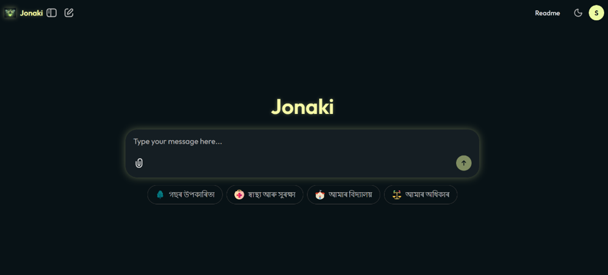
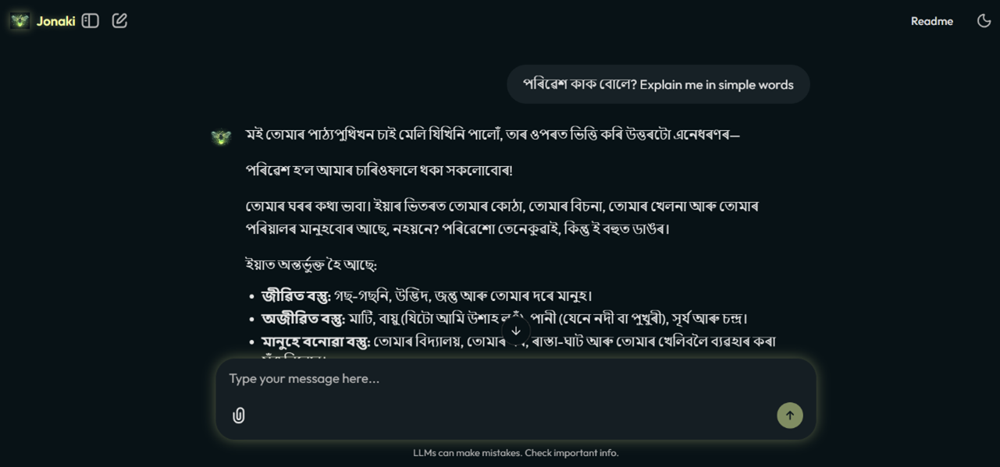
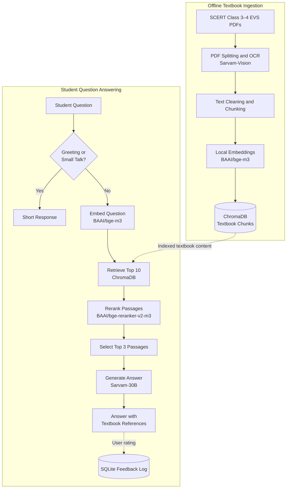

<p align="center">
  
</p>

<p align="center">
  <strong>An AI learning companion for Assamese students</strong><br />
  SCERT Class 3–4 Environmental Studies · Assamese-first learning
</p>


# Jonaki (জোনাকী) — Assamese AI Tutor for Primary Education


[](https://www.gnu.org/licenses/gpl-3.0)
[](https://chainlit.io/)
[](https://github.com/AvinabhDutta-Dev/jonaki)

**Status: Baseline prototype.** This repository contains the initial working prototype of Jonaki, built as a major B.Tech project — scoped to Class 3 & 4 Environmental Science (EVS/পৰিৱেশ) for Assamese-medium schools. The architecture here is being extended toward a broader goal: an Assamese-native AI tutor for competitive exam preparation (APSC), answering exclusively from verified past question papers.


## Table of Contents

- [The Problem](#the-problem)
- [What Jonaki Does](#what-jonaki-baseline-does)
- [See Jonaki in Action](#see-jonaki-in-action)
- [System Architecture](#-system-architecture)
- [Results and Evaluation](#results-and-evaluation)
- [Tech Stack](#-tech-stack)
- [Project Structure](#-project-structure)
- [Setup](#-setup)
- [Data Pipeline](#-data-pipeline-offline-setup)
- [Running the App](#-running-the-app)
- [Requirements](#-requirements)
- [Notes](#-notes)


## The Problem

Global AI models like ChatGPT and Gemini are heavily optimized for English. When Assamese-medium students — especially young learners — try to use them, the models frequently code-switch into Hindi or English mid-response, give answers that are too advanced or off-syllabus, and generally fail to serve a low-resource language community of over 15 million speakers reliably.

## What Jonaki (Baseline) Does

Jonaki is a Retrieval-Augmented Generation (RAG) chatbot designed to answer questions using indexed official SCERT Class 3–4 EVS textbook content. It retrieves relevant passages and uses them to generate age-appropriate Assamese answers with textbook page references. The current prototype aims to reduce unsupported answers and language mixing, but does not guarantee their complete elimination. It:

- OCRs source textbook PDFs using **Sarvam-Vision** (built for Assamese script)
- Chunks and embeds the content, storing it in **ChromaDB**
- Retrieves and reranks relevant passages for each student question
- Generates simple, age-appropriate Assamese answers via **Sarvam-30B**, grounded with textbook page citations
- Routes common greetings and small-talk messages using keyword-based rules, while educational questions go through the RAG pipeline
- Maintains per-student session memory and login (via Chainlit's auth + SQLite data layer)
- Collects thumbs-up/down feedback and stores feedback records in SQLite for later analysis; feedback logging does not currently train or update the model


## See Jonaki in Action

<p align="center">
  
</p>

<p align="center">
  
</p>


## 🧠 System Architecture

Jonaki uses an offline ingestion pipeline to prepare Assamese textbook content and a runtime RAG pipeline to answer student questions.



### How the pipeline works

1. **Prepare the data:** Textbook PDFs are split, OCR-processed, cleaned, and divided into chunks.
2. **Retrieve relevant content:** The student's question is embedded and used to retrieve the 10 most relevant chunks from ChromaDB.
3. **Rerank the results:** A cross-encoder reranks the retrieved passages, and the top 3 are selected as context.
4. **Generate the answer:** Sarvam-30B uses the retrieved context to generate an Assamese response with textbook references.
5. **Collect feedback:** Student ratings are stored in SQLite for later analysis; they do not automatically retrain the model.

*Note: This diagram represents the implemented baseline flow. It does not imply a measured accuracy level or guaranteed hallucination prevention.*


## Results and Evaluation

Jonaki is currently a baseline prototype for Assamese-medium primary education. It implements a retrieval-augmented generation (RAG) pipeline for answering questions about SCERT Class 3–4 Environmental Science (EVS) textbook content.

### Implemented Capabilities

- **Textbook retrieval:** Embeds student questions using BAAI/bge-m3 and retrieves up to 10 relevant chunks from ChromaDB.
- **Passage reranking:** Uses BAAI/bge-reranker-v2-m3 to select up to 3 passages as context for answer generation.
- **Answer generation:** Uses Sarvam-30B to generate responses based on the retrieved textbook context.
- **Source references:** Displays textbook class and page references using the retrieved chunks' metadata when available.
- **Feedback collection:** Records helpful and not-helpful ratings, along with the corresponding question and answer, in SQLite.
- **Historical feedback data:** Includes `data/rlhf_feedback_dataset.csv` for inspection and further analysis. These records are not, by themselves, a formal measure of model quality.

### Evaluation Status

The repository does not currently report benchmark-based scores for answer correctness, retrieval quality, citation support, Assamese language quality, or response latency.

The script `scripts/test_provider.py` provides basic checks of the Sarvam client and its API calls; it explicitly is not a comprehensive unit test suite. These checks should not be treated as an evaluation of the complete RAG pipeline or the quality of its answers.

A formal evaluation would require a documented set of representative questions, reference answers or relevant textbook passages, a consistent evaluation procedure, and recorded results.

**Current status:** The core retrieval, reranking, response-generation, and feedback-logging components are implemented. Quantitative answer-quality evaluation remains future work.


## 🛠️ Tech Stack

| Component | Technology |
|---|---|
| LLM |  |
| OCR |  (Assamese-optimized) |
| Embeddings |  (sentence-transformers) |
| Reranker |  |
| Vector DB |  (persistent, local) |
| Chunking |  `MarkdownNodeParser` |
| UI / Orchestration |  |
| Session Storage |  (via Chainlit's SQLAlchemy data layer) |
| Feedback Logging | Custom feedback logger →  |


## 📁 Project Structure

```
jonaki/
├── src/                    # Live application
│   ├── chainlit_app.py     # Main app: auth, routing, RAG pipeline
│   ├── chroma_client.py
│   ├── ingest_to_chroma.py
│   ├── provider_clients.py # Sarvam API wrapper + local reranker
│   └── rl_logger.py        # RLHF feedback logging
├── scripts/                 # One-time data pipeline
│   ├── split_pdf.py
│   ├── batch_ocr.py
│   ├── clean_markdown.py
│   ├── chunk_text.py
│   ├── cloud_ingestion.py   # Colab-specific variant
│   ├── reset_chroma.py
│   └── test_provider.py
├── data/
│   ├── pdfs/                 # Source SCERT textbooks (not included — copyrighted curriculum material)
│   ├── cleaned_text/
│   └── rlhf_feedback_dataset.csv   # Historical feedback export
├── textbook_chunks/           # Processed JSONL chunks
├── public/                     # Custom Chainlit theme (firefly branding)
├── .chainlit/                   # Chainlit config
├── Notebooks/
│   └── Jonaki.ipynb              # Development notebook
├── Paper/
│   └── major_project_report.docx
├── chainlit.md                    # Welcome screen (Assamese)
├── requirements.txt
└── .env.example
```

> **Note:** Source textbook PDFs are not included in this repository, as SCERT/SEBA curriculum materials are copyrighted state educational content, not original work.

## ⚙️ Setup

### 1. Clone the repository

```bash
git clone https://github.com/AvinabhDutta-Dev/jonaki.git
cd jonaki
```

### 2. Create a virtual environment

**Python version used:** Python 3.13 (64-bit).

**Windows (PowerShell):**

```powershell
python -m venv .venv
.venv\Scripts\Activate.ps1
```

**Linux / macOS:**

```bash
python3 -m venv .venv
source .venv/bin/activate
```

### 3. Install dependencies

```bash
python -m pip install --upgrade pip
pip install -r requirements.txt
```

### 4. Configure environment variables

Create a `.env` file by copying `.env.example`.

**Windows (PowerShell):**

```powershell
Copy-Item .env.example .env
```

**Linux / macOS:**

```bash
cp .env.example .env
```

Open `.env` and set the following values:

```env
SARVAM_API_KEY=your_actual_sarvam_api_key
CHAINLIT_AUTH_SECRET=your_unique_random_secret
```

- `SARVAM_API_KEY`: Your Sarvam API key, used for the provider services configured by the application.
- `CHAINLIT_AUTH_SECRET`: A private secret used by Chainlit's authentication/session mechanisms. Generate a unique, sufficiently random value for your own environment.

**Security:** Never commit your real `.env` file or publish API keys and secrets. Keep `.env.example` limited to placeholders.

### 5. Prepare the textbook index

If you are setting up the project from scratch, obtain the required textbook PDFs and follow the [Data Pipeline](#-data-pipeline-offline-run-once) steps to prepare the chunks and ChromaDB index.

### 6. Run Jonaki

```bash
chainlit run src/chainlit_app.py
```

Follow the terminal output to access the local Chainlit interface.

> **Important:** The demo login (`student` / `1234`) is for project demonstration only. Do not use these credentials for a public deployment or real student accounts. The application also depends on the required textbook index being available locally.

## 📊 Data Pipeline (offline setup)

Run these steps from the repository root. The source textbook PDFs are not included, so obtain the required PDFs separately and place them in `data/pdfs/`.

If the input folder does not exist, create it first:

```bash
python -c "from pathlib import Path; Path('data/pdfs').mkdir(parents=True, exist_ok=True)"
```

Place your source textbook PDFs in `data/pdfs/` before continuing.

### 1. Split the textbook PDFs

```bash
python scripts/split_pdf.py
```

Reads PDFs from `data/pdfs/` and writes smaller PDF files to `data/split_pdfs/` (five pages per file by default).

### 2. Extract text using OCR

```bash
python scripts/batch_ocr.py
```

Uses the Sarvam OCR service to process the split PDFs and saves Markdown output in `textbook_txt/`. Configure `SARVAM_API_KEY` in your `.env` file first.

### 3. Clean the extracted text

```bash
python scripts/clean_markdown.py
```

Removes image tags and empty links, then writes cleaned Markdown files to `data/cleaned_text/`.

### 4. Create text chunks

```bash
python scripts/chunk_text.py --input-dir data/cleaned_text --output-dir textbook_chunks
```

Processes cleaned Markdown files using LlamaIndex's Markdown-aware parser and writes JSONL chunk files to `textbook_chunks/`. The current implementation does not enforce the `--chunk-size` or `--overlap` values.

### 5. Build the ChromaDB index

```bash
python src/ingest_to_chroma.py
```

Generates local embeddings and stores the chunks and metadata in the persistent ChromaDB index at `./chroma_db/` by default.

**Note:** OCR requires a working Sarvam API key. The indexing step downloads and loads the local embedding model, so it may take time and require sufficient memory. Keep the generated `chroma_db/` directory available when running the application.

## ▶️ Running the App

Run the following command from the repository root after completing the setup and ensuring the local ChromaDB index is available.

```bash
chainlit run src/chainlit_app.py
```

Open the local URL displayed in the terminal.

**Demo login:** `student` / `1234`

These hardcoded credentials are for project demonstration only. Do not use them for a public deployment or real user accounts.

**Important:** The application loads local embedding and reranking models at startup and uses Sarvam for chat responses. First-time model downloads and loading may take time. Keep your `SARVAM_API_KEY` configured and never commit your real `.env` file.

## 📦 Requirements

`llama-index`, `chromadb`, `chainlit`, `requests`, `pymupdf`, `python-dotenv`, `sarvamai`, `sentence-transformers`

## 📝 Notes

- This is a **baseline prototype**, not a production system. The architecture (RAG + Sarvam models + ChromaDB + Chainlit) is designed to generalize to other subjects and exam types — the next planned direction is repurposing this pipeline for APSC exam preparation.
- The mock authentication (`student`/`1234`) was implemented for project defense/demo purposes only - not intended as real user authentication.
- **Evaluation and safety limitations:** Quantitative performance claims require a documented evaluation procedure. The current prototype does not guarantee that every response is fully grounded or that language mixing will never occur.
- Team: Avinabh Dutta, Saurav Dutta, Nisha Dey, Bhumika Baishya. Supervisor: Dr. Chandana Dev.
